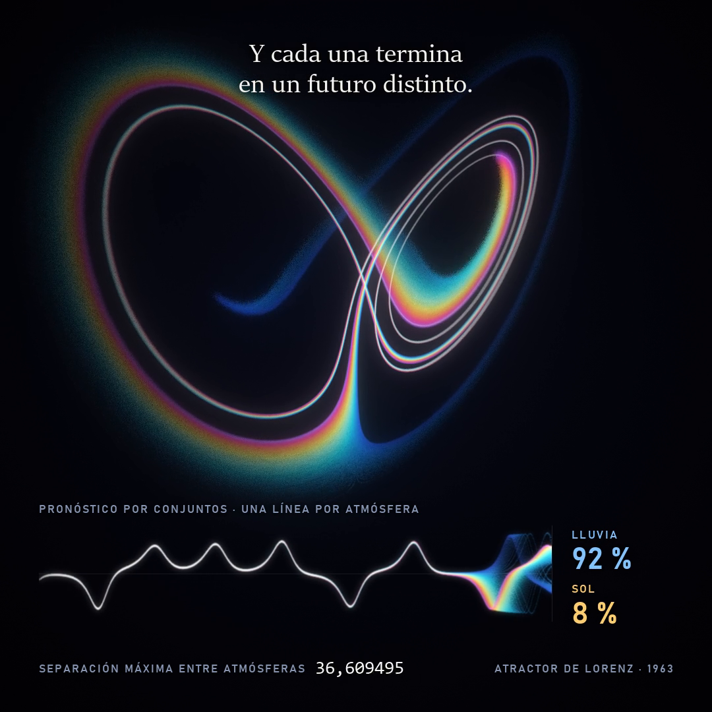
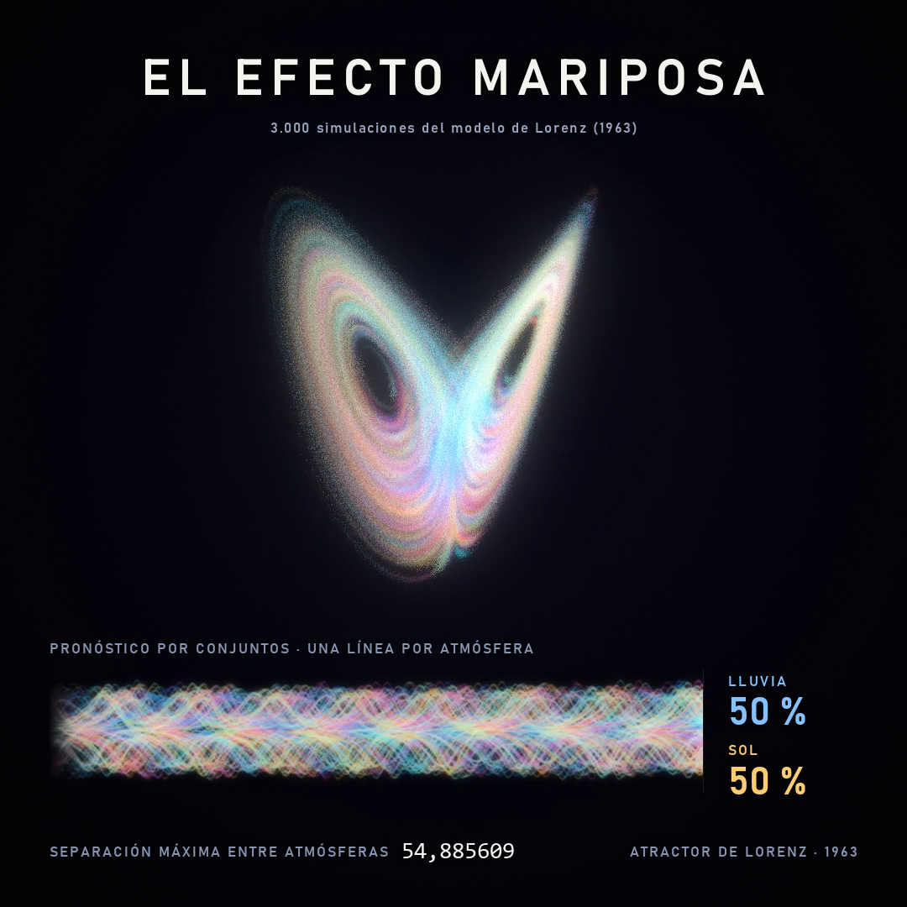

# Butterfly Effect

One wingbeat is enough to change tomorrow. 3,000 atmospheres simulated at once with the Lorenz model (1963), as a video rendered entirely on the CPU and as an interactive web page.

**Interactive version:** https://chaos.meruw.dev



## What it shows

In 1963 Edward Lorenz reduced atmospheric convection to three equations:

```
dx/dt = σ (y − x)
dy/dt = x (ρ − z) − y
dz/dt = x y − β z          σ = 10, ρ = 28, β = 8/3
```

The video simulates 3,000 copies of that system. They all start at almost the same point: the difference between the first and the last one is one millionth. Each copy has its own color.

1. At first all 3,000 coincide, and the sum of every color looks like a single white light.
2. The difference grows exponentially. When it reaches the size of the screen, the light opens into a spectrum: each color is an atmosphere that took a different path.
3. In the end every atmosphere is somewhere else on the attractor.

### The chart at the bottom is a forecast

Weather services do not simulate one atmosphere but many nearly identical ones (ensemble forecasting), and count in how many of them it rains. The lower band of the video is that same chart: one line per atmosphere, showing its `x` position over time.

The counter on the right uses an analogy: if one wing of the attractor were rain and the other sun, how many of the 3,000 atmospheres are on each? While they coincide it reads 100 % and 0 %. Once they diverge it settles near 50 % and 50 %. In the actual model the wings correspond to the direction of the convective roll, not to rain and sun.

The number in the footer is the largest separation between atmospheres, measured in the simulation on every frame.



## Interactive version

[`docs/index.html`](docs/index.html) is a dependency-free page that runs the same simulation in the browser with WebGL 2. It has a single knob: the initial difference, from one trillionth to one tenth.

The page opens with the butterfly already split and alive, and one line: "One wingbeat is enough to change tomorrow". On start, every atmosphere collapses onto the starting point and the story tells itself, slowly, until the light splits; that is where control is handed over. It can be skipped.

Every launch logs how long the atmospheres stayed together. Trying several differences reveals the underlying result: making the initial measurement a thousand times more precise only buys a few more time units of reliable forecast.

Tapping the butterfly flaps its wings: every atmosphere collapses into a single light, wherever one of them happens to be, and they set off again.

Sound is optional and follows the same idea as the video: while the atmospheres stay together the theme plays, and once they split the melody improvises. Every note is also visible: it releases a ripple and a pulse of brightness. One thing differs from the video: every position of the knob has its own song. There are twelve, each with its own key, chord progression and timbres (electric piano, celesta, kalimba, glass, harp and bells, through FM synthesis). On top of that, zoom makes it brighter or more distant, rotation moves each wing across the stereo field according to where it is on screen, and the separation between atmospheres lengthens the echo.

The page is available in English and Spanish, with a button to switch.

On a phone the simulation and the knob fit on one screen. To keep it smooth, the forecast chart is drawn on the GPU, only 64 atmospheres with more weight are drawn while they coincide (they look identical), trails use fewer segments in their older part, and the number of atmospheres drops automatically if the device cannot keep up.

The source is `web/butterfly-effect.html`. `web/build.py` generates `docs/`, which is what GitHub Pages serves: the standalone page with social preview tags and the `CNAME` file for the domain. `web/make_og.py` composes the preview image from a frame of the video.

## How the render works

- **Integration:** second-order Runge-Kutta with a fixed step of 0.0025, in double precision.
- **Trails without screen memory:** each atmosphere is drawn as 400 particles that follow exactly the same numerical trajectory, each with a different lag. The trail exists in 3D, so the camera can move without smearing it.
- **Density rendering:** 1.2 million particles are projected through a perspective camera and accumulated into a histogram of linear light. Depth of field comes from offsetting each particle according to its distance from the focal plane.
- **Development:** automatic exposure, logarithmic curve, glow, anamorphic streak and vignette.
- **Cold open and rewind:** a first pass renders the moment of divergence and places it at the start of the video. Then the butterfly rewinds, using frames from the film itself, down to the point of light the story starts from.
- **Performance:** particles are split across 8 processes and handled in blocks of 4,096 that fit in cache. No GPU is used and it runs at low priority.

## The butterfly plays the music

There is an original 16-note theme, written for this project: each phrase opens with a leap of a sixth and comes down stepwise. `sound.py` has the central atmosphere play it.

- **The theme, while they stay together:** every loop around the attractor gives the next note of the theme, at the instant it happens. The loops set the rhythm; the notes are composed.
- **Left hand:** at the bottom of every loop a broken-chord note sounds (root, fifth, octave, fifth), with a piano timbre.
- **One chord every four loops:** D, B minor, G and A, with a bass note on each change.
- **The wing decides the side** in the stereo field, and on the left wing the melody is doubled an octave lower.
- **Once they split, the theme dissolves:** the melody improvises stepwise on the pentatonic scale (up if the loop was larger, down if it was smaller) and four other atmospheres accompany softly, each following its own loops.
- **Ending:** the first phrase of the theme returns, slower with each note.

The theme, the chords, the pad, the harp glissando that rises into the moment of divergence and the ending are composition, not data. The theme does not quote any existing work.

## Usage

```bash
pip install -r requirements.txt
```

```bash
python butterfly.py --out out/butterfly_effect.mp4
```

That command renders the video, synthesizes the audio and muxes it in. `--lang en,es` produces both languages in a single pass (the second one is saved as `butterfly_effect_es.mp4`).

To try changes quickly, render single frames at half resolution:

```bash
python butterfly.py --scale 0.5 --stills 0,3.6,9,19
```

| Option | What it does | Default |
| --- | --- | --- |
| `--lang` | Caption language: `en`, `es` or `en,es` | `en` |
| `--scale` | Resolution relative to 1080×1080 | `1.0` |
| `--fps` | Frames per second | `60` |
| `--workers` | Simulation processes | `8` |
| `--trail` | Trail length in the final act, in steps | `100` |
| `--tail` | Length of the final act, in seconds | `10` |
| `--crf` | H.264 quality (lower is better) | `16` |
| `--no-audio` | Skip synthesizing and muxing the soundtrack | |
| `--info` | Only print the schedule of the video | |

Caption fonts are the ones that ship with Windows (Sitka, Bahnschrift, Cambria, Consolas); on other systems Pillow's default font is used.
